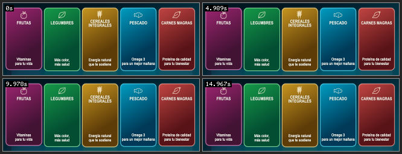

# AE AI
### De una instrucción a una composición editable en After Effects

**Asistente de inteligencia artificial para artistas de motion graphics, editores y equipos de producción audiovisual.**

Diseña, construye, modifica y revisa composiciones de Adobe After Effects desde un panel conversacional, sin abandonar tu proyecto.

[**Solicitar una demostración**](https://github.com/JuniorMM0110/after-effects-ai-agent/issues/new?template=solicitud-comercial.yml) · [**Explorar funciones**](docs/FUNCIONALIDADES.md) · [**English**](README.en.md) · [**Ver novedades**](AVANCES-AE-AI.md)

**Versión en desarrollo: 0.5.4** · **macOS / Windows** (compilaciones de prueba) · **Adobe After Effects**

---

## ¿Qué es AE AI?

AE AI conecta una interfaz tipo chat con Adobe After Effects mediante un servidor local y herramientas de automatización. En lugar de limitarse a explicar cómo crear una animación, **puede actuar directamente en una composición**, conservando capas, keyframes y precomposiciones editables.

La propuesta está orientada a reducir tareas repetitivas y acelerar primeras versiones de piezas animadas, sin quitarle al diseñador el control creativo ni sustituir su criterio profesional.

## Lo que puedes hacer

| Área | Capacidades disponibles o en prueba |
|---|---|
| **Construcción de escenas** | Crear composiciones, textos, formas, capas, keyframes, expresiones, efectos y controladores mediante instrucciones. |
| **Modificación inteligente** | Inspeccionar una composición existente, modificar elementos y organizar la jerarquía de capas. |
| **Animación** | Ejecutar animaciones temporizadas, movimientos de cámara, parenting, profundidad y transiciones. |
| **Referencias visuales** | Adjuntar archivos de imagen o video y utilizar referencias durante la elaboración. |
| **Revisión visual** | Capturas, hojas de contacto y pruebas de calidad para revisar distintos momentos de la composición. |
| **Motion Review** | La IA recibe hojas de contacto reales y fechadas de toda la animación y puede revisar visualmente zonas problemáticas tras corregirlas; también existe un modo para generar un clip a FPS originales, pero no es percepción continua de video. |
| **Productividad** | Historial de conversaciones, presets, plantillas y controles para reducir contexto innecesario. |
| **Integración** | Panel CEP dentro de After Effects, puente local y herramientas MCP. |

> **Estado real:** AE AI está en desarrollo. Las primeras composiciones pueden requerir intervención humana y ajustes de keyframes, enmascarado, animación o composición. Algunas funciones avanzadas, como revisión totalmente autónoma y reproducción continua en tiempo real, siguen en evolución.

## Del prompt al resultado

1. **Describe** la escena o mejora que necesitas en lenguaje natural.
2. **AE AI inspecciona** el proyecto y organiza operaciones sobre la composición.
3. **Construye o modifica** capas, efectos, keyframes y elementos editables.
4. **Revisa** capturas, movimiento muestreado y criterios de calidad cuando corresponde.
5. **Tú decides:** conserva el resultado, ajusta la escena o solicita otra iteración.

## Demostración visual

Ver más muestras de trabajo

Estas demostraciones ilustran recursos y pruebas del proyecto. No implican que todas las animaciones se generen sin supervisión ni representan una certificación de calidad de producción.

## Para quién puede servir

**Productoras y canales de televisión:** asistencia para crear y revisar paquetes gráficos, promos, titulares y elementos recurrentes.

**Agencias creativas y equipos de marketing:** prototipado de animaciones, composición de títulos y variantes de piezas audiovisuales.

**Motion designers y editores independientes:** automatización de operaciones de After Effects y soporte para iteraciones rápidas.

**Equipos que desarrollan flujos con IA:** integración de acciones estructuradas sobre proyectos reales mediante MCP y un puente local.

## Disponibilidad y compatibilidad

| Entorno | Situación |
|---|---|
| **Adobe After Effects 2026 en macOS Intel** | Entorno principal de desarrollo y pruebas del panel. |
| **macOS Apple Silicon** | Compilación de instalador preparada; falta ampliar pruebas en hardware real. |
| **Windows x64** | Instalador compilado; pendiente su validación integral en un equipo Windows. |
| **Acceso a IA** | Se conecta mediante una sesión de Codex/ChatGPT compatible; disponibilidad, modelos y cuotas dependen de la cuenta y sus condiciones. |

AE AI **no ofrece cuota de IA ilimitada**. El consumo puede variar significativamente según la complejidad de la tarea. El proyecto busca reducir llamadas redundantes y mostrar métricas de uso; no controla el porcentaje de cuota que calcula OpenAI.

## ¿Quieres probarlo o colaborar?

Estamos interesados en conversar con empresas, agencias, profesionales y socios tecnológicos que quieran **solicitar una demostración, evaluar un piloto o explorar una colaboración**.

[**→ Enviar una consulta comercial o solicitar una demo**](https://github.com/JuniorMM0110/after-effects-ai-agent/issues/new?template=solicitud-comercial.yml)

También puedes revisar la [presentación comercial detallada](docs/PRESENTACION-COMERCIAL.md), el [estado técnico](AVANCES-AE-AI.md) y las [preguntas frecuentes](docs/PREGUNTAS-FRECUENTES.md).

**No hay precios, licencias comerciales ni fechas de lanzamiento públicas confirmadas.** Las propuestas deben conversarse según el alcance y las condiciones de cada caso. El código actual y los instaladores privados no se distribuyen desde este repositorio público.

## Código abierto y atribuciones

El proyecto utiliza componentes del [After Effects MCP de Engine Room Games](https://github.com/Engine-Room-Games/after-effects-mcp), con licencia MIT. Conservamos las atribuciones y obligaciones de los componentes de código abierto. La licencia [MIT histórica](LICENSE) y el historial de código anteriormente publicado no se revocan por utilizar un repositorio privado para continuar el desarrollo. Consulta las [aclaraciones sobre distribución y licencias](docs/LICENCIAS-Y-DISTRIBUCION.md).

---

**AE AI — Motion graphics asistido por IA, conservando el control creativo.**

[Solicitar demostración](https://github.com/JuniorMM0110/after-effects-ai-agent/issues/new?template=solicitud-comercial.yml) · [Funcionalidades](docs/FUNCIONALIDADES.md) · [Novedades](AVANCES-AE-AI.md)

